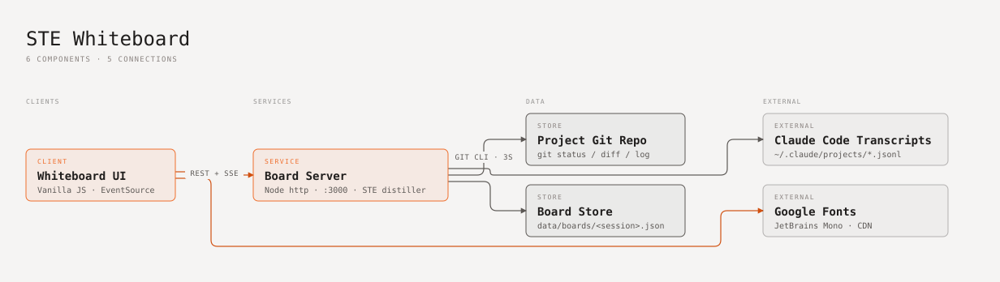

# STE Whiteboard

A live whiteboard for a Claude Code session. It reads the session log and the git
working tree. It shows each turn as cards in ASD-STE100 Simplified Technical English.

The STE rules are a guideline. The target is 75–80% compliance, not 100%.

## Run

```bash
npm run dev
```

Open http://localhost:3000. The server has no dependencies. It needs Node 20 or later.

By default the board tracks the folder where you start the server. To track a
different project, set `PROJECT_DIR`:

```bash
PROJECT_DIR=~/code/my-app npm run dev
```

## Architecture



- **Whiteboard UI** (`public/app.js`): the browser client. It gets data from the board server through REST and gets live updates through SSE.
- **Board Server** (`server/index.js`): a Node HTTP server on port 3000. It rewrites text into STE statements and builds the cards.
- **Claude Code Transcripts**: the server reads the session log files every second.
- **Project Git Repo**: the server runs `git` every 3 seconds to get changed files and commits.
- **Board Store** (`data/boards/`): JSON files for card positions, hidden cards and notes.
- **Google Fonts**: supplies the JetBrains Mono font.

Start with the board server and the whiteboard UI.

## How it works

| Part | File | Job |
| --- | --- | --- |
| Board server | `server/index.js` | Serves the UI, REST API and SSE stream on port 3000. |
| Transcript reader | `server/transcript.js` | Reads `~/.claude/projects/<project>/*.jsonl` and groups entries into turns. |
| STE distiller | `server/ste.js` | Rewrites text into short STE statements and scores each one. |
| Board store | `server/board.js` | Builds cards and saves positions, hidden cards and notes in `data/boards/`. |
| Git poller | `server/git.js` | Reads branch, uncommitted files and commits every 3 seconds. |
| Whiteboard UI | `public/` | Pan/zoom canvas, cards, notes and the STE inspector. |

Each turn is one row on the board:

- **REQUEST**: your prompt, written as commands.
- **PROGRESS**: Claude's status updates during the turn.
- **CHANGES**: files created or changed, shell commands and architecture-map updates.
- **RESULT**: Claude's final reply for the turn.

## STE rules applied

| Rule | What the distiller does |
| --- | --- |
| LENGTH | Splits sentences longer than 20 words (steps) or 25 words (descriptions). |
| ACTIVE | Flags passive voice. |
| VERB | Flags "-ing" verb forms. |
| CLEAR | Flags vague words such as "maybe" and "probably". |
| WORDS | Replaces words that are not approved ("utilize" → "use") and removes fillers. |
| STEPS | Turns "I will…" and "Let me…" into commands. Numbers each step. |
| CAUTION | Puts a CAUTION flag on statements about risk or failure. |

Code, file paths and URLs stay as they are.

## Controls

- Drag the board to move. Ctrl + scroll or pinch to zoom.
- Drag a card header to move the card. Click a card to see its STE checks.
- Double-click the board or press `n` to add a note. Use **REWRITE AS STE** on a note.
- Use the zoom control at the bottom right (`−`, `+`, click the percentage to reset to 100%). Below 60% zoom, each card shows only its first statement in larger text.
- `f` or **Fit** fits all cards in view. **Tidy** puts the cards back in the turn grid.
- A card shows up to 6 statements. Click **+N MORE** to see the rest.
- `i` or the panel button hides or shows the inspector. The board remembers your choice.
- **Export .md** downloads the board as an STE Markdown document.

## Test

```bash
npm test
```
